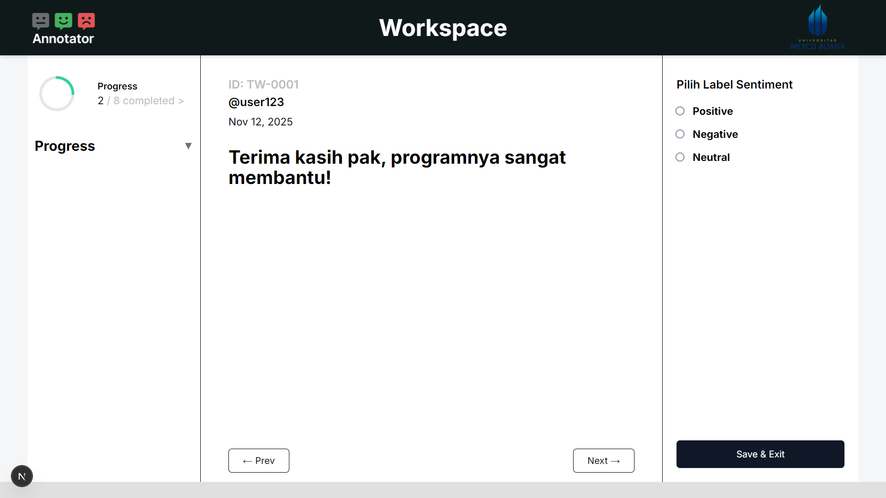

# Annotation-Web

A web-based annotation platform for labeling text data for sentiment analysis.

## Overview

Annotation-Web is a web application designed to simplify text annotation by allowing users to assign sentiment labels to comments. The labeled data can be used to support sentiment analysis and Natural Language Processing (NLP) research.

## Application Preview



## Features

- **Text Annotation** — Label individual text comments.
- **Sentiment Classification** — Categorize comments as Positive, Negative, or Neutral.
- **Annotation Workspace** — View and annotate comments in a dedicated workspace.
- **Progress Tracking** — Monitor annotation progress.

## Tech Stack

- React.js
- TypeScript
- Tailwind CSS

## Getting Started

### Prerequisites

- Node.js
- npm

### Installation

1. Clone this repository:

   ```bash
   git clone https://github.com/HaryoPamungkas/Annotation-Web.git
   ```

2. Navigate to the project directory:

   ```bash
   cd Annotation-Web
   ```

3. Install dependencies:

   ```bash
   npm install
   ```

4. Start the development server:

   ```bash
   npm run dev
   ```

5. Open the local URL displayed in your terminal.

## Purpose

This project was developed to support text annotation workflows for sentiment analysis research.

## License

No license has been specified.
